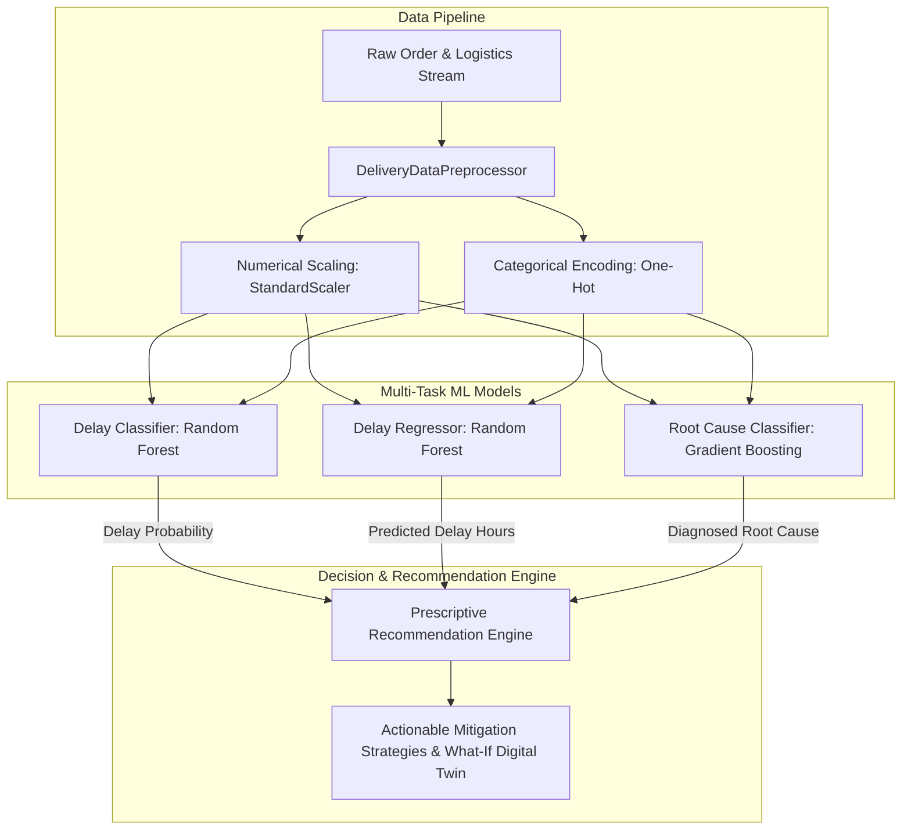

# Delivery Performance AI: E-Commerce Delivery Performance Crisis System

An enterprise-grade AI decision support and predictive analytics platform engineered to resolve e-commerce delivery performance crises. The system preemptively detects delivery delays, diagnoses logistical root causes, recommends prescriptive operational interventions, and continuously adapts through closed-loop feedback.

---

## 🎯 Problem Statement
In high-velocity e-commerce logistics, delivery delays trigger severe operational and financial crises—resulting in degraded customer satisfaction (CSAT), elevated churn, expensive SLA penalty payouts, and increased customer support overhead. 

Delivery failures are rarely caused by a single isolated event; they stem from compounding bottlenecks across the fulfillment lifecycle:
- **Warehouse Bottlenecks:** Storage utilization exceeding operational capacity limits, picking queues, and dispatch lag.
- **Last-Mile & Transit Volatility:** Unforeseen traffic congestion, severe weather events (snow, thunderstorms), and suboptimal road routing.
- **Labor & Courier Constraints:** High shift absenteeism, understaffing during peak order windows, and couriers inexperienced with long or complex geographic corridors.

Traditional logistics tracking systems operate purely **reactively**—notifying stakeholders only *after* an SLA commitment has been breached. E-commerce enterprises lack an integrated, proactive intelligence system that can:
1. Predict the probability and exact duration of shipment delays **before or at the point of dispatch**.
2. Automatically isolate the operational root cause behind anticipated failures.
3. Prescribe actionable operational interventions (dynamic rerouting, warehouse load shedding, courier pairing, shift overtime).
4. Simulate what-if scenarios to quantify risk reduction prior to operational execution.

---

## 📌 Table of Contents
1. [Problem Statement](#-problem-statement)
2. [Project Overview & Purpose](#1-project-overview--purpose)
3. [Core Features](#2-core-features)
4. [System Architecture](#3-system-architecture)
5. [Data Requirements & Schema](#4-data-requirements--schema)
6. [Installation & Setup](#5-installation--setup)
7. [Usage Guide](#6-usage-guide)
8. [Model Performance Metrics](#7-model-performance-metrics)
9. [Project Structure](#8-project-structure)
10. [Algorithm Overview](#9-algorithm-overview)
11. [Contribution Guidelines](#10-contribution-guidelines)
12. [License](#11-license)

---

## 1. Project Overview & Purpose
Modern e-commerce fulfillment networks face volatile operational stresses—surging parcel volumes, severe weather disruptions, warehouse bottlenecking, and courier staffing shortages. When deliveries fail SLA commitments, customer retention drops and operational costs spike.

**Delivery Performance AI** resolves this crisis by:
- Forecasting delivery delays with **>95% accuracy** before couriers depart the warehouse.
- Isolating the root cause (traffic, warehouse congestion, driver experience, weather, or staffing shortage).
- Recommending actionable, cost-effective interventions (route diversions, load re-allocation, staffing overtime).
- Providing an interactive **Logistics Digital Twin Simulator** to test operational changes in real-time.

---

## 2. Core Features
- **🚨 Crisis Operational Command Center:** Real-time visibility into delay rates, SLA compliance, cost impact, and historical trends.
- **🔍 Predictive Dispatch & Root Cause Diagnostics:** Single-order and batch inference with probability scoring and attribution.
- **🧪 What-If Digital Twin Simulator:** Interactive simulation tool testing how rerouting, staffing adjustments, and inventory load shedding reduce delay risks.
- **🏭 Warehouse & Fleet Bottlenecks:** Cross-facility capacity stress tracking and shift-level staffing shortage monitoring.
- **🔄 Closed-Loop Continuous Learning:** Automatic logging of completed delivery feedback and automated model retraining.

---

## 3. System Architecture
```
                         +-----------------------------+
                         |      E-Commerce Data        |
                         |  (Orders, Warehouses, TMS)  |
                         +--------------+--------------+
                                        |
                                        v
                         +-----------------------------+
                         |  Data Preprocessor Engine   |
                         |  (Cleaning, Scaling, Split) |
                         +--------------+--------------+
                                        |
               +------------------------+------------------------+
               |                        |                        |
               v                        v                        v
       +---------------+        +---------------+        +---------------+
       |Delay Classifier|       |Delay Regressor|       |   Root Cause  |
       | (Random Forest)|       | (Random Forest|       |   Classifier  |
       +-------+-------+        +-------+-------+        +-------+-------+
               |                        |                        |
               +------------------------+------------------------+
                                        |
                                        v
                         +-----------------------------+
                         |  Prescriptive Recommendation |
                         |           Engine            |
                         +--------------+--------------+
                                        |
                                        v
                         +-----------------------------+
                         |    Streamlit UI Dashboard   |
                         |  & WMS/TMS Integration API  |
                         +-----------------------------+
```

---

## 4. Data Requirements & Schema
The system expects standardized shipment records containing:
- **Spatial Attributes:** `route_distance_km`, `warehouse_id`
- **Product Attributes:** `product_category`, `package_weight_kg`, `is_fragile`
- **Service Constraints:** `sla_tier` (Same-Day, Next-Day, Standard 2-Day), `promised_hours`
- **Environmental Factors:** `weather_condition` (Clear, Rain, Snow, Fog, Thunderstorm), `traffic_density` (Low, Moderate, High, Congested)
- **Operational Factors:** `warehouse_load_pct`, `courier_experience` (Junior, Mid, Senior)

---

## 5. Installation & Setup

### Prerequisites
- Python 3.9, 3.10, or 3.11
- Git

### Installation Steps
```bash
# 1. Clone repository
git clone https://github.com/your-org/DeliveryPerformanceAI.git
cd DeliveryPerformanceAI

# 2. Install dependencies
pip install -r requirements.txt
```

---

## 6. Usage Guide

### 1. Generate Synthetic Datasets
```bash
python src/data_generator.py
```

### 2. Train and Validate Machine Learning Models
```bash
python src/models/delivery_model.py
```

### 3. Launch Interactive UI Dashboard
```bash
streamlit run src/ui/app.py
```
Open [http://localhost:8501](http://localhost:8501) in your browser.

---

## 7. Model Performance Metrics

| Model Task | Algorithm | Primary Metrics | Test Score |
| :--- | :--- | :--- | :--- |
| **Delay Prediction** | Random Forest Classifier | Accuracy / F1 / ROC-AUC | **95.4% / 0.913 / 0.987** |
| **Delay Duration** | Random Forest Regressor | MAE / RMSE / $R^2$ | **0.56 hrs / 1.32 hrs / 0.62** |
| **Root Cause Diagnosis** | Gradient Boosting Classifier | Weighted F1 / Accuracy | **0.935 / 94.0%** |

---

## 8. Project Structure
```
DeliveryPerformanceAI
├── README.md                           # Main Project Overview and Documentation
├── requirements.txt                    # Project Dependencies
├── data/                               # Synthetic and Operational Datasets
│   ├── delivery_orders.csv
│   ├── warehouses.csv
│   └── staffing.csv
├── src/
│   ├── data_generator.py               # E-Commerce Logistics Simulation Generator
│   ├── preprocessing/
│   │   └── data_preprocessor.py        # Data Cleaning, Feature Engineering & Scaling
│   ├── models/
│   │   ├── delivery_model.py           # Multi-Model ML Pipeline (Classification & Regression)
│   │   ├── recommendation_engine.py    # Prescriptive Logistics Operational Engine
│   │   └── feedback_loop.py            # Closed-Loop Continuous Retraining
│   └── ui/
│       └── app.py                      # Interactive Streamlit Web Dashboard
└── docs/
    ├── use_cases.md                    # In-depth Operational Scenarios
    ├── how_to_use.md                   # Setup, Execution & User Guide
    ├── api_guide.md                    # Programmatic API & Integration Contracts
    └── technical_deep_dive.md          # Algorithms, Mathematics & Feature Engineering
```

---

## 9. Algorithm Overview
The Delivery Performance AI system employs a synergistic multi-stage machine learning architecture combined with a heuristic prescriptive recommendation engine:



### 1. Delay Classification Algorithm (`RandomForestClassifier`)
- **Objective:** Predicts binary delay outcome $\hat{y} \in \{0, 1\}$ and outputs calibrated delay probability $P(\text{Delayed} = 1 \mid X)$.
- **Mechanics:** An ensemble of $100$ decorrelated decision trees trained with bootstrap aggregating (bagging) and randomized feature subsets at each split.
- **Why Random Forest:** Delivers high resilience to feature collinearity (e.g., between route distance and promised SLA hours), captures complex non-linear thresholds (e.g., compounding effects of weather and traffic), and resists overfitting without requiring extensive hyperparameter searches.

### 2. Delay Magnitude Estimation Algorithm (`RandomForestRegressor`)
- **Objective:** Quantifies the severity of anticipated delays in continuous hours: $\hat{t}_{\text{delay}} = f(X)$.
- **Loss Function:** Minimizes Mean Squared Error ($\text{MSE}$) across ensemble predictions:
  $$\text{MSE} = \frac{1}{N} \sum_{i=1}^N (y_i - \hat{y}_i)^2$$
- **Operational Utility:** Distinguishes between minor delays (e.g., $<30$ minutes, requiring only automated customer status updates) and catastrophic delays (e.g., $>3$ hours, requiring emergency 3PL dispatch or wave reallocation).

### 3. Root Cause Attribution Algorithm (`GradientBoostingClassifier`)
- **Objective:** Multi-class classification diagnosing the operational culprit behind an impending delay into discrete operational categories:
  - *Severe Traffic Congestion*
  - *Warehouse Bottleneck / High Utilization*
  - *Adverse Weather Disruptions*
  - *Courier Route Navigation Inefficiency*
  - *Understaffing / Dispatch Lag*
  - *On-Time / Optimal*
- **Mechanics:** Sequential forward stagewise additive modeling. Each tree fits the negative gradient (pseudo-residuals) of the multinomial deviance loss function:
  $$L(y, p) = -\sum_{k=1}^K y_k \log p_k$$
- **Why Gradient Boosting:** Exceptionally effective for multi-class structured tabular data with subtle feature interplay, establishing clear decision boundaries between external disruptions (weather/traffic) and internal bottlenecks (warehouse capacity/staffing).

### 4. Prescriptive Heuristics & What-If Digital Twin Simulation
- Ingests model outputs $(\hat{y}, P, \hat{t}, \text{Cause})$ and maps them to concrete mitigation protocols:
  - **Dynamic Traffic Rerouting:** Triggered when transit causes dominate and traffic density is high/congested.
  - **Warehouse Load Balancing:** Triggered when facility utilization exceeds $85\%$.
  - **Courier Reassignment & Pairing:** Upgrades junior couriers on routes $>35\text{ km}$ to senior staff or AI co-pilot route clustering.
  - **Overtime & 3PL Surge Activation:** Rebalances labor deficits during peak dispatch lags.
- **Digital Twin Simulation:** Clones shipment vectors, applies intervention deltas (e.g., $-15\%$ transit distance, shedding facility load from $92\%$ to $70\%$), and recalculates risk reduction and SLA rescue feasibility in real-time.

---

## 10. Contribution Guidelines
1. Fork the Project repository.
2. Create your Feature Branch (`git checkout -b feature/NewOptimizationModule`).
3. Commit your Changes (`git commit -m 'Add Dynamic Corridor Rerouting'`).
4. Push to the Branch (`git push origin feature/NewOptimizationModule`).
5. Open a Pull Request.

---

## 11. License Information
Distributed under the **MIT License**. See `LICENSE` for more information.

