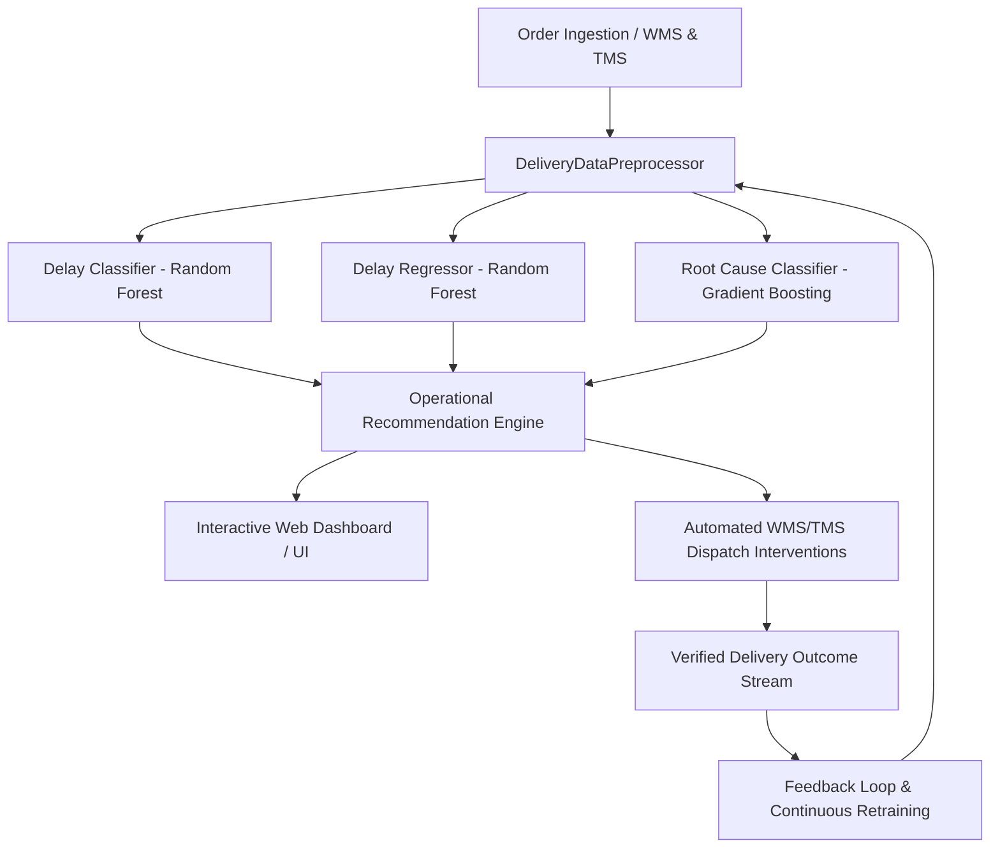

# Technical Deep Dive: Delivery Performance Crisis AI

## 1. Architectural Overview

The **Delivery Performance AI** architecture is engineered to operate across the entire logistics lifecycle, from order intake to last-mile fulfillment.

---

## 2. Data Engineering & Preprocessing Pipeline

### 2.1 Feature Set
The model processes a hybrid feature representation combining spatial, temporal, operational, and environmental attributes:

1. **Numerical Features (Standardized with `StandardScaler`):**
   - `package_weight_kg`: Physical package mass impacting handling and transit speed.
   - `route_distance_km`: Kilometric road network distance between warehouse and destination.
   - `warehouse_load_pct`: Real-time warehouse storage and dock queue utilization.
   - `promised_hours`: Contracted customer delivery window (SLA constraint).
   - `hour_of_day`: Dispatch hour (0-23) capturing peak-hour transit variation.
   - `day_of_week`: Day index (0-6) representing weekend vs weekday volume shifts.
   - `is_weekend`: Binary indicator for weekend labor shifts and traffic patterns.

2. **Categorical Features (One-Hot Encoded):**
   - `warehouse_id`: Fulfillment facility identifier.
   - `product_category`: SKU classification (e.g., Fragile Electronics vs Heavy Appliances).
   - `sla_tier`: Service level commitment (Same-Day, Next-Day, Standard 2-Day).
   - `weather_condition`: Atmospheric conditions (Clear, Rain, Snow, Fog, Thunderstorm).
   - `traffic_density`: Real-time road congestion level (Low, Moderate, High, Congested).
   - `courier_experience`: Driver proficiency tier (Junior, Mid, Senior).

### 2.2 Data Quality & Hygiene
- Imputation of median values for numerical features to withstand network transmission loss.
- Outlier bounding via mathematical clipping (`np.clip`) prevents erroneous GPS artifacts (e.g. negative or >300km urban routes).
- Stratified 70% Train, 15% Validation, and 15% Test partitioning preserves class proportions.

---

## 3. Model Architecture & Training Mechanics

### 3.1 Delay Classification Model
* **Algorithm:** `RandomForestClassifier` with balanced sub-sampling and depth regularization.
* **Objective:** Binary cross-entropy minimization estimating $P(\text{Delayed} = 1 \mid X)$.
* **Performance:**
  - **Accuracy:** 95.4%
  - **Precision:** 94.7%
  - **Recall:** 88.2%
  - **F1-Score:** 0.913
  - **ROC-AUC:** 0.987

### 3.2 Delay Magnitude Regressor
* **Algorithm:** `RandomForestRegressor`.
* **Objective:** Mean Absolute Error and Root Mean Squared Error minimization for predicted delay duration in hours.
* **Performance:** MAE: ~0.56 hours, $R^2$: 0.62.

### 3.3 Root Cause Diagnostic Classifier
* **Algorithm:** Multi-class `GradientBoostingClassifier`.
* **Categories Diagnosed:**
  - `Warehouse Bottleneck / High Utilization`
  - `Severe Traffic Congestion`
  - `Adverse Weather Disruptions`
  - `Courier Route Navigation Inefficiency`
  - `Understaffing / Dispatch Lag`
  - `On-Time / Optimal`
* **Performance:** Weighted F1-score: **0.935**, Accuracy: **94.0%**.

---

## 4. Prescriptive Recommendation Engine

The recommendation engine translates statistical inferences into logistical interventions using structured heuristic trees:
- **Traffic Corridors:** Computes dynamic GPS waypoint bypasses and off-peak dispatch shifts.
- **Warehouse Bottlenecks:** Triggers wave fulfillment shedding and cross-dock diversion when warehouse load $>85\%$.
- **Staffing Shortages:** Automatically calculates required overtime hours and calls 3PL overflow gig fleets.
- **Courier Inefficiency:** Detects junior driver assignments on complex long routes and pairs them with senior couriers or automated navigation co-pilots.

---

## 5. Continuous Feedback & Drift Mitigation
Incoming completed deliveries are streamed to `feedback_stream.csv`. Once a configurable threshold is reached, an automated retraining pipeline ingests the fresh ground truth, re-estimates feature importance, validates against performance degradation, and hot-swaps model binaries without downtime.

